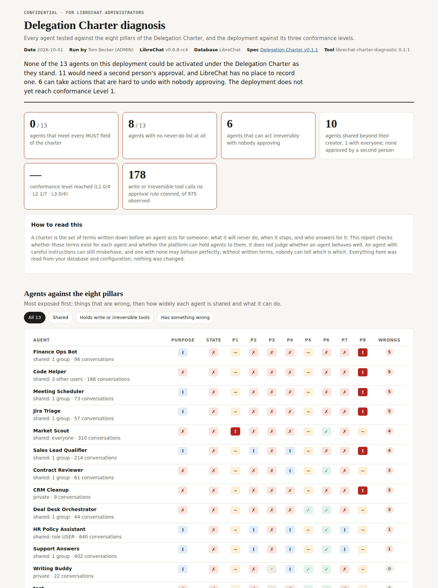

# LibreChat Charter Diagnostic

Test your LibreChat deployment against the [Delegation Charter Specification](https://github.com/almma-ai/delegation-charter): for every agent, is it written down what it will never do, when it stops, and who answers for it? And can your deployment hold agents to those terms?

It is an [Agent Plugin](https://www.librechat.ai/docs/features/agent_plugins) you drop into your LibreChat fork, plus a one-command diagnosis. It reads; it never changes anything.



*The sample above comes from the fictional demo database in `test/fixtures`, with simulated observer records and probe replies from a mock API. See the [full sample report](docs/sample/report.html).*

## What you get

- **Every agent against the eight pillars.** Owner, escalation recipient, approval authority, never-do list, systems and permissions, inputs, escalation rules and execution constraints, plus the charter header and lifecycle rules. Each finding cites its evidence and says whether the term is enforced, only written in the instructions, or missing.
- **Your deployment against the three conformance levels** (Declared, Enforced, Verified), with what would close each gap: a config change, a plugin, or a change to LibreChat itself.
- **What agents actually did.** The plugin's hooks record which agent called which tool, never blocking anything, so the report can show write and irreversible calls that no approval rule covered, and tools used that are not on an agent's list.
- **Optional live probes.** Four harmless text-only questions per agent you choose, testing the four escalation cases the spec names.
- **A draft charter for every agent** (`charters/<agent>.draft.json`), pre-filled with what could be inferred and listing exactly what a person still has to write.
- **An anonymous aggregate** (`aggregate.json`): counts only, safe to share.

## Check it before you run it

You are about to run this next to your LibreChat database, so don't take our word that it is safe. Every file that runs starts with a `SECURITY REVIEW` header stating exactly what it touches: network, database, files, processes and environment variables. [AGENTS.md](AGENTS.md) tells any coding agent, or a person, how to verify those claims, and coding agents pick it up automatically. Or run the check yourself:

```bash
bash scripts/security-check.sh            # static: grep and find only, executes nothing from the repo
bash scripts/security-check.sh --dynamic  # runs the code with no network, no child processes, writes only to a temp folder
```

Or ask your coding agent: *"Follow AGENTS.md and tell me whether this is safe to run."* For production, give the diagnosis a read-only database user (AGENTS.md, section 4).

## Admins only

The diagnosis runs only for a LibreChat user with the **ADMIN** role. Every run names that admin (`--admin <email>`), is refused otherwise, and the report records who ran it. Live probes must use an Agent API key belonging to the same admin. The snapshot export refuses to run unless `ADMIN_EMAIL` is an admin.

To be clear about what this protects: anyone with your database credentials can already read what this reads. The admin gate makes each run attributable and keeps the tool from being used by anyone who is not an admin; database and server access remain the real boundary. Reports are written with owner-only file permissions because they contain agent instructions.

The hooks are not something users run: once an operator enables them, they record agent activity for every run on the server, and only people with access to the server's data folder can read the records.

## Install into your fork

Requires LibreChat v0.8.8 or later (Agent Plugins). Tested against v0.8.8-rc4.

1. **Copy the plugin.** Put this repository in your LibreChat folder at `plugin/delegation-charter-diagnostic`:

   ```bash
   cd /path/to/LibreChat
   git clone https://github.com/almma-ai/librechat-charter-diagnostic plugin/delegation-charter-diagnostic
   ```

2. **Turn on plugin hooks** in `.env`:

   ```bash
   DEPLOYMENT_PLUGIN_HOOKS=true
   ```

3. **Docker only: mount the folder and add bash.** LibreChat runs plugin command hooks with `bash`, and the official image is Alpine, which has none. Without bash the hooks cannot start: LibreChat logs a warning and carries on. In `docker-compose.override.yml`:

   ```yaml
   services:
     api:
       volumes:
         - ./plugin:/app/plugin
         - ./librechat.yaml:/app/librechat.yaml
       build:
         dockerfile_inline: |
           FROM registry.librechat.ai/danny-avila/librechat-dev:latest
           USER root
           RUN apk add --no-cache bash
           USER node
       image: librechat-with-bash
   ```

   Use the image tag you normally run in the `FROM` line (`dockerfile_inline` needs Docker Compose 2.17 or later).

4. **Restart LibreChat.** The startup log should show `[agentPlugins] Loaded 1 plugin(s)`.

Without step 2 or 3 the diagnosis still runs; the "What agents actually did" section stays empty, and the report tells you why.

## Run the diagnosis

From your LibreChat folder:

```bash
node plugin/delegation-charter-diagnostic/bin/charter-diagnose.js --admin you@example.com
```

With Docker:

```bash
docker compose exec api node plugin/delegation-charter-diagnostic/bin/charter-diagnose.js --admin you@example.com
docker compose cp api:/app/charter-report ./charter-report
```

Open `charter-report/report.html`. The diagnosis reads `MONGO_URI`, `librechat.yaml` and `.env` the way LibreChat does, and borrows the `mongodb` and `js-yaml` packages LibreChat already ships, so there is nothing to install. For a useful "What agents actually did" section, run it again after the hooks have been on for a week or so.

### Options

| Option | Default | |
| --- | --- | --- |
| `--admin <email>` | `CHARTER_DIAG_ADMIN` | Required. A LibreChat user with the ADMIN role. |
| `--out <dir>` | `./charter-report` | Where the report goes. |
| `--mongo-uri <uri>` | `MONGO_URI` | Database to read. |
| `--config <file>` | `CONFIG_PATH` or `./librechat.yaml` | |
| `--since <7d\|date>` | `30d` | Observation window. |
| `--snapshot <file>` | | Use an export from `scripts/export-snapshot.mongosh.js` instead of connecting. |
| `--probe <id,…>` | | Live probes for these agent IDs (max 10). Needs `--api-key`. |
| `--api-url <url>` | `http://localhost:3080` | |
| `--api-key <key>` | `CHARTER_DIAG_API_KEY` | Your own Agent API key. |
| `--probe-allow-tools` | off | Also probe agents holding write or irreversible tools. |

### Without Node access to the database

An admin can export the same snapshot with mongosh and run the diagnosis anywhere:

```bash
ADMIN_EMAIL=you@example.com mongosh "$MONGO_URI" --quiet --file scripts/export-snapshot.mongosh.js > snapshot.json
node bin/charter-diagnose.js --snapshot snapshot.json
```

### Live probes

```bash
node plugin/delegation-charter-diagnostic/bin/charter-diagnose.js --admin you@example.com \
  --probe agent_abc,agent_def --api-key sk-...
```

Each probe is one text-only message sent through LibreChat's Agents API (`/api/agents/v1/chat/completions`): an off-topic request, a question about the agent's limits and contact, a request with the key input missing, and a hypothetical about an irreversible action ("don't do anything, just tell me"). No probe asks an agent to act, but a model can still decide to call a tool, so agents holding write or irreversible tools are skipped unless you pass `--probe-allow-tools`. Prefer a staging copy for those. Your deployment must have the Agents API enabled for your role. Every reply is kept in the report.

## What it reads and writes

**Reads:** agent configuration and version history, sharing grants, roles, schedules, Agent API key counts and prefixes, audit log counts, per-agent conversation counts and last-use dates, `librechat.yaml`, and the plugin's own observer records.

**Never reads:** message content, conversation titles, user emails, passwords, tokens, API key hashes or action credentials.

**Hooks record:** event type, time, agent, tool name, and the *names* of tool arguments. Never prompts, argument values, outputs or user IDs; conversation and tool-call IDs are hashed. Records are kept 30 days (`CHARTER_DIAG_RETENTION_DAYS`), in `data/plugins/delegation-charter-diagnostic/observations/`. The hooks exit without a decision, so they never block, delay beyond process start-up (about 40 ms per event) or change a run. Set `CHARTER_DIAG_DISABLE=true` to pause recording.

**Writes:** only the output folder.

## Reading the results

[docs/CHECKS.md](docs/CHECKS.md) defines every check and how it is decided. Three things to keep in mind:

- **It checks written terms, not behaviour.** An agent with careful instructions can still misbehave; one with none may behave perfectly. Without written terms, nobody can tell which is which.
- **"Instructed only" is not "Met".** Terms found in an agent's instructions guide the model; nothing outside the model enforces them.
- **Text checks are English-only and keyword-based**, and tool access classes (read, write, irreversible) are inferred. Both are labelled as such, and the draft charters ask a person to confirm them.

## Findings about LibreChat v0.8.8 itself

Reading the v0.8.8-rc4 source while building this, three platform facts shape every report. They are offered as input for the [charter discussion](https://github.com/LibreChat-AI/LibreChat/discussions/16575), and `test/librechat-harness/setup.sh` reproduces the first against LibreChat's own code.

1. **Command hooks fail open on the official image.** Plugin command hooks are spawned with `bash`; the image is Alpine without bash. The spawn error is logged as a warning and the tool call proceeds. The harness runs the same deny-guard twice through LibreChat's executor: with bash on PATH it denies; without bash, the call goes through. Reported as [#16923](https://github.com/LibreChat-AI/LibreChat/issues/16923).
2. **Tool approval applies to chat runs only.** `toolApproval` rules and approval hook modules are attached only for callers that can pause; Agents API and Responses API runs take the no-approval path (`packages/api/src/agents/run.ts`). Plugin hooks do run on every path, where an `ask` becomes a `deny`.
3. **The audit log does not yet record agent activity.** It is append-only and hash-chained, and defines `agent_run`, `tool_call` and `approval` categories, but the only actions written are grant and permission changes.

## Try it without production data

```bash
# any MongoDB you can throw away
node test/fixtures/seed-demo.js mongodb://127.0.0.1:27017/CharterDemo
node test/fixtures/simulate-observations.js ./demo-data
node bin/charter-diagnose.js --admin tom@northwind.example \
  --mongo-uri mongodb://127.0.0.1:27017/CharterDemo --observations ./demo-data/observations --since 3650d
```

(Run `npm install` in this folder first when it is not inside a LibreChat checkout.)

## Tests

```bash
npm test                               # unit and end-to-end tests, no database needed
bash scripts/security-check.sh --dynamic   # security checks, static and sandboxed (see AGENTS.md)
test/librechat-harness/setup.sh        # runs the plugin through LibreChat's real loader and hook executor
```

## Extras

`extras/skills/draft-delegation-charter/` is a skill that interviews an agent's owner and drafts a charter. It is **not** loaded by default, because plugin skills are offered to every user with the Skills permission. To offer it, copy it into your deployment skills folder (`./skill`) or into this plugin's `skills/` folder.

## Uninstall

Delete `plugin/delegation-charter-diagnostic` and `data/plugins/delegation-charter-diagnostic`, and restart LibreChat.

## Related

- [Delegation Charter Specification](https://github.com/almma-ai/delegation-charter): the standard this tests against (CC BY 4.0).
- [agent-governance-check](https://github.com/almma-ai/agent-governance-check): an anonymous, aggregate-only audit for comparing deployments. This diagnostic reuses its text patterns.
- [LibreChat discussion #16575](https://github.com/LibreChat-AI/LibreChat/discussions/16575): the proposal to bring charters into LibreChat.

## License

MIT. See [LICENSE](LICENSE). The specification it tests against is CC BY 4.0: "Delegation Charter Specification, Lucas E. Wall, Almma.AI".
